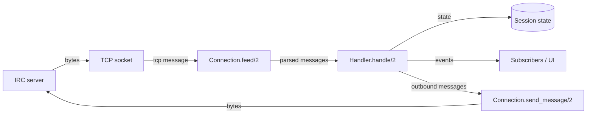
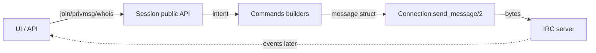
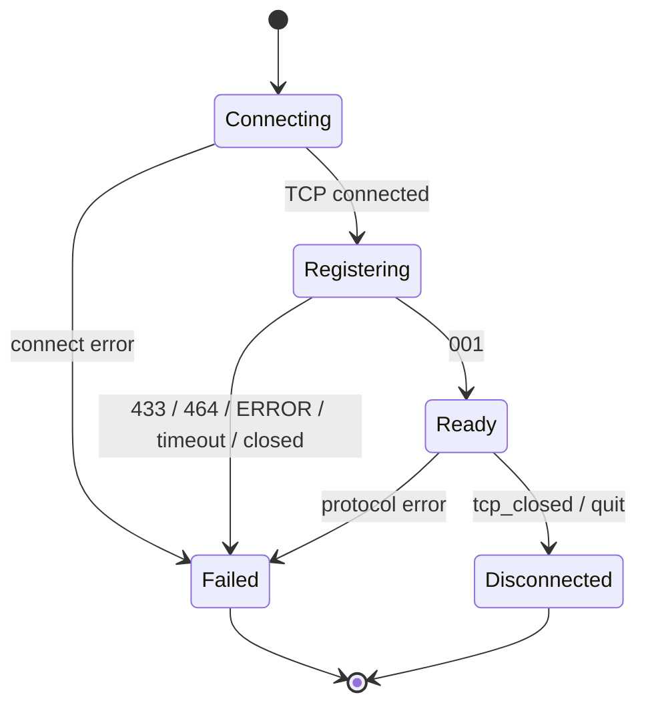
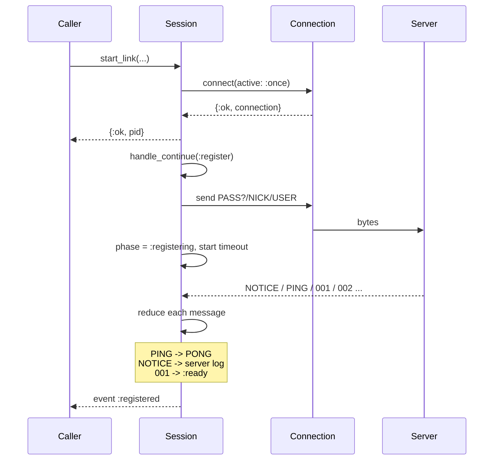

# Session 3.5 — Asynchronous IRC and the connection lifecycle

Status: **design-session plan**, not a wrap-up guide. The goal is to draw and
agree on the model before writing production code or rewriting tests.

## Why this session

Exercise 3 added a `Session` process, but the implementation still treats the
network as a synchronous request/response API. `Registration.register/3` calls
`Connection.recv_message/2` in a loop, and `Session` then switches the socket to
active mode. The result is two input paths, a raw-line queue that both
`Connection` and `Session` interpret differently, and a `handle_irc_message/3`
that only knows `PING` and `NOTICE`.

That last point is not just a missing clause. On a normal IRC welcome burst the
session receives `001`, `002`, `005`, MOTD lines, and `NOTICE`s. Anything other
than `PING`/`NOTICE` raises `FunctionClauseError`, so the session dies. The test
suite is green because the fake server only scripts the three messages the tests
need.

The root cause is a design mismatch:

> IRC is not request/response. It is an asynchronous event stream.

This session fixes the mental model first. The refactor follows from it.

## Decisions already made

- Move to **active socket input from the start**; do not keep passive
  registration as a second production path.
- Replace `handle_irc_message/3` with a **reducer**.
- Model the lifecycle explicitly: **connect → register → ready**.
- Tests may be rewritten or dropped; the current `Session` tests describe the
  narrow old contract, not the behavior we want.
- Typespecs, `String.Chars`, field guards, and similar cleanup are **out of
  scope** for this session.

Open decisions are listed at the end. The point of the session is to settle
them, not to write code.

## Learning outcomes

By the end of the session you should be able to:

1. Explain why IRC is not request/response and why a generic `recv_until`
   helper does not generalize.
2. Draw the inbound and outbound flows and say which module owns each step.
3. Draw the connection lifecycle state machine, including registration,
   timeout, failure, and disconnect.
4. Explain how registration completes without blocking the session process.
5. Explain how a command with a correlated reply (`WHOIS`, `LIST`) is
   implemented with pending requests and deferred replies.
6. Define the first failing behavior test for the refactor.

## The model: commands are intents, events are facts

The useful analogy is not HTTP request/response. It is closer to a chat room or
a message bus:

- The client sends **commands**.
- The server broadcasts **events** to everyone, at any time.
- Some events are **replies** to a command, but the correspondence is not
  one-to-one, and unrelated events can arrive in between.

| Concept | Direction | Meaning | Example |
| --- | --- | --- | --- |
| Command | client → server | Intent. Usually fire-and-forget. | `JOIN #elixir`, `PRIVMSG #elixir :hi` |
| Event | server → client | Fact. May be unrelated to anything you just sent. | `JOIN`, `PART`, `PRIVMSG`, `QUIT`, `NOTICE` |
| Reply | server → client | Numeric response. Zero, one, or many per command. | `001`, `433`, `318`, `323` |
| Request | client-side | Correlation between one command and the replies it expects. | `WHOIS alice` → `311` … `318` |

Key sentences to keep in mind:

- `Connection.send_message/2` returning `:ok` means **the bytes were written**,
  not that the command succeeded.
- `001` is not the return value of `NICK`. It is an event that means “the server
  accepted the registration.”
- The server may send `PING`, `NOTICE`, or `PRIVMSG` between `NICK` and `001`.
  The client must handle them while still registering.
- Correlation is application-level. IRC has no request IDs for most commands;
  the client correlates by target (`nick`, `channel`) and expected numeric.

This is the same shift as `GenServer.call/3` versus `cast`/`handle_info`:
`call` is a request/response abstraction built on asynchronous messages. IRC
gives you the asynchronous messages; you build correlation only where a caller
actually needs it.

## Two flows

### Inbound



`Connection.feed/2` owns framing and parsing. `Handler.handle/2` owns protocol
decisions. The shell owns side effects and subscriber notification.

### Outbound



The outbound path never waits for the outcome. `join/2` returns “sent” or an
error writing to the socket. The channel appears when the `JOIN` event arrives.

### Responsibility split

| Concern | Owner |
| --- | --- |
| Socket, framing, parsing | `Connection` (value) |
| Command construction | `Commands` (pure) |
| Protocol decisions and state transitions | `Handler` (pure reducer) |
| Lifecycle, timers, subscribers, calls | `Session` (process) |
| Rendering | terminal / LiveView adapters |

The boundary test: after `001`, `Registration` should disappear from the story.
A `PRIVMSG` should go `Connection` → `Session`/`Handler` → event. If routing a
message still requires registration knowledge, the boundary is wrong.

## Connection lifecycle state machine



| State | Incoming message | Action | Next state |
| --- | --- | --- | --- |
| `:connecting` | connect succeeds | send `PASS?`/`NICK`/`USER`, start timer | `:registering` |
| `:registering` | `PING` | send `PONG` | `:registering` |
| `:registering` | `NOTICE`, other numeric | append to server log, emit event | `:registering` |
| `:registering` | `001` | cancel timer, emit `:registered` | `:ready` |
| `:registering` | `433` / `464` / `ERROR` | emit failure, close | `:failed` |
| `:registering` | timer fires | emit timeout, close | `:failed` |
| `:ready` | `PING` | send `PONG` | `:ready` |
| `:ready` | `PRIVMSG` / `JOIN` / `PART` / numerics | update conversation state, emit events | `:ready` |
| any | unknown command | emit `:unknown`/server event | unchanged |
| any | `tcp_closed` | emit disconnected, close | `:disconnected` |

The table is the whole design. “Waiting for `001`” is just being in
`:registering`. “Waiting for a `WHOIS` reply” is a pending request in `:ready`.
Nothing blocks.

## Registration without blocking



The important changes from today:

- `start_link/4` returns as soon as the process is initialized. It does **not**
  wait for the network handshake.
- `init/1` connects in active mode and returns
  `{:ok, state, {:continue, :register}}`.
- `handle_continue(:register, state)` sends the handshake, sets
  `phase: :registering`, and starts a timeout timer.
- Every inbound message goes through the same reducer, regardless of phase.
  `PING` is answered in every phase. Other messages are logged/emitted. `001`
  transitions to `:ready`. `433`/`464`/`ERROR`/timeout/`tcp_closed` transition
  to a failure state.

A realistic welcome burst arriving in one TCP read is now harmless:
`Connection.feed/2` returns all complete lines, the reducer handles them in
order, `001` flips the phase, and the following `002`/`005`/MOTD lines become
server-log events.

### Readiness

Two options:

1. **Event-first (recommended):** `start_link` returns immediately; callers and
   tests subscribe and wait for `{:irc_event, :registered}`. The UI can show
   “connecting/registering/ready.”
2. **Convenience waiter:** `Session.await_ready(pid, timeout)` uses
   `GenServer.call/3`. If already ready, reply immediately; if registering,
   store the caller in the state; reply when `001` arrives or fail on timeout.
   This keeps the process unblocked and gives scripts a synchronous-looking API.

Use events as the primary contract; add `await_ready/2` only if it earns its
keep.

### Failure policy

- **Connect error:** `init/1` returns `{:stop, reason}`; `start_link` returns
  `{:error, reason}`.
- **Registration failure:** the process already started. Emit the failure event,
  close the socket, then stop with a reason. Supervision (Exercise 5) decides
  whether to restart. For manual `iex` inspection, an option to stay in
  `:failed` could be considered, but don’t add it by default.
- **`tcp_closed`:** emit a disconnected event, close, stop normally or with
  `:closed`. The current code has no clause for this and crashes.

## Correlated replies: `WHOIS`, `LIST`, `NAMES`

Some commands expect a terminal numeric:

| Command | Reply stream | Terminal |
| --- | --- | --- |
| `WHOIS alice` | `311`, `312`, `313`, `317`, `319` … | `318` |
| `LIST` | `321`, many `322` | `323` |
| `NAMES #chan` | `353` … | `366` |

Implement this with a pending-request map, not a blocking receive loop:

```text
handle_call({:whois, nick}, from, state)
  → send WHOIS nick
  → pending[{:whois, nick}] = %{from: from, acc: ..., timer: ref}
  → {:noreply, state}

handle_info 318 (end of WHOIS)
  → pop pending[{:whois, nick}]
  → GenServer.reply(from, {:ok, acc})
  → state
```

Timeouts are messages too:

```text
handle_info {:pending_timeout, key}
  → GenServer.reply(from, {:error, :timeout})
  → remove pending[key]
```

Caveats:

- IRC has no request IDs for these commands. Correlation is by target: nick or
  channel. Two concurrent `WHOIS` requests for the same nick cannot be
  distinguished; serialize or replace.
- Not every command needs correlation. `JOIN`, `PART`, and `PRIVMSG` are
  intents; their effects arrive as events. The UI should update from the event
  stream, not from the command return value.
- `PING`/`PONG` is not request/response from the client’s perspective. The
  server sends `PING`; the client answers. Handle it as a global clause, not as
  a pending request.

## Reducer and event shape

A small result type keeps the shell thin:

```elixir
@type result ::
        {:continue, state, [Event.t()], [Message.t()]}
        | {:stop, reason, state, [Event.t()]}
```

- `{:continue, state, events, outbound}`: update state, notify subscribers,
  send outbound messages.
- `{:stop, reason, state, events}`: notify subscribers, close the socket, stop.
- The reducer is total. An unknown command becomes an `:unknown` or `:server`
  event; it never raises.
- The reducer is pure: no socket calls, no `send/2`, no timers. The shell
  performs those.

Sketch:

```elixir
def handle(state, %Message{command: "PING", params: params}) do
  {:continue, state, [], [%Message{command: "PONG", params: params}]}
end

def handle(%{phase: :registering} = state, %Message{command: "001"} = msg) do
  event = %Event{type: :registered, conversation: :server, message: msg}
  {:continue, %{state | phase: :ready}, [event], []}
end

def handle(state, %Message{} = msg) do
  event = %Event{type: :server, conversation: :server, message: msg}
  {:continue, append_server_log(state, msg), [event], []}
end
```

The exact event struct can start minimal:

```elixir
%Event{
  type: :registered | :message | :notice | :numeric | :unknown | :disconnected,
  conversation: :server | {:channel, String.t()} | {:user, String.t()},
  message: %Message{},
  nick: String.t() | nil,
  text: String.t() | nil
}
```

Add fields only when a test needs them.

### State shape

```elixir
%State{
  phase: :connecting | :registering | :ready | :failed | :disconnected,
  connection: %Connection{},
  identity: %{nick: ..., username: ..., realname: ..., password: ...},
  nick: nil | String.t(),
  channels: %{},
  queries: %{},
  server_log: [],
  pending: %{},
  registration_timer: nil | reference(),
  subscribers: MapSet.new()
}
```

For the first refactor, `channels`/`queries`/`server_log` can be minimal; the
structure is the point. A channel/query is data, not a process.

## Proposed module boundaries

| Module | Responsibility | Kind |
| --- | --- | --- |
| `Exirc.IRC.Connection` | Socket, `feed/2` (bytes → parsed messages), `send_message/2`, `activate/2`, `close/1` | value |
| `Exirc.IRC.MessageFraming` / `MessageParser` / `MessageFormatter` | Codec | pure |
| `Exirc.IRC.Commands` | Outbound builders: `nick/1`, `user/3`, `pong/1`, `join/1`, `privmsg/2`, `whois/1`, `quit/1` | pure |
| `Exirc.IRC.Registration` | Handshake message builder; optional pure transition helpers | pure |
| `Exirc.IRC.Handler` | Inbound reducer: state + message → result | pure |
| `Exirc.IRC.Event` | Normalized event data | pure |
| `Exirc.IRC.Session` | GenServer shell: lifecycle, timers, subscribers, public API | process |
| `Exirc.IRC.State` | Session state struct (optional; a map is fine at first) | pure data |

What happens to the current pieces:

- `Registration.register/3`: remove from the production path. Keep
  `Registration.messages/1` (pure) and move flow decisions into the reducer.
- `Connection.recv_message/2`: keep only as a low-level/manual helper if it is
  still useful; do not build protocol flows on it. If it becomes dead code,
  delete it.
- `handle_irc_message/3`: replaced by `Handler.handle/2`.
- `:inet.setopts` in `Session`: replaced by `Connection.activate/2`, or removed
  entirely because the socket starts active.

## Test plan

### Pure handler tests

- `PING` in `:registering` and `:ready` → `PONG`, phase unchanged.
- `001` in `:registering` → `:ready`, `:registered` event.
- `433` / `464` / `ERROR` → failure event and stop.
- `NOTICE` in `:registering` → server-log event, phase unchanged.
- `002` / `005` / `372` in `:ready` → server-log events, no crash.
- Unknown command → `:unknown` event, no crash.
- `PRIVMSG #chan` → channel event and channel state (Exercise 4).
- `PRIVMSG own_nick` → query event (Exercise 4).
- Registration timeout → timeout event and stop.

### Integration tests with `FakeIRCServer`

- A realistic welcome burst in one write:
  `NOTICE`, `PING :token`, `001`, `002`, `005`, `375`, `372`, `376`.
  Assert `PONG`, `:registered`, server-log events, process alive, no duplicates.
- The same burst split across several writes; same result.
- `PING` during registration; `PONG` sent and registration still completes.
- `433` before `001`; failure event and socket closed.
- Server closes during registration; failure/disconnected event.
- Server closes while `:ready`; disconnected event, no crash.
- `start_link` returns before `001`; readiness is observed via event or
  `await_ready/2`.

### First red test for the next coding session

> **The session survives a realistic welcome burst and emits server events.**

Steps:

1. Start `FakeIRCServer`.
2. `Session.start_link(host, port, registration, observer: self())` returns
   `{:ok, pid}` before the handshake completes.
3. Server accepts and reads `NICK`/`USER`.
4. Server sends `NOTICE`, `PING :token`, `001`, `002`, `005`, MOTD lines.
5. Assert the server receives `PONG :token`.
6. Assert the observer receives `:registered` and server-log events for the
   NOTICE/numerics/MOTD.
7. Assert the process is alive.

This test fails on the current implementation (it crashes) and drives the new
state machine.

### Existing tests

- Keep the codec tests (framing, parser, formatter); they are stable.
- Rewrite `Connection` tests around `feed/2`, `send_message/2`, `activate/2`,
  `close/1`. Keep a few passive `recv_message` tests only if the helper stays.
- Keep `Registration.messages/1` tests; replace `register/3` flow tests with
  session lifecycle tests.
- Rewrite `Session` tests for the event contract and realistic bursts.
- Keep `FakeIRCServer`; it is the deterministic boundary.

## Open decisions for the session

1. **One process or two?** `Session` owns both socket and state (simpler), or a
   separate `Connection` process owns the socket and `Session` subscribes
   (cleaner separation, more message passing). Recommendation: one process for
   now; revisit if multiple networks or reconnect make the socket lifecycle
   independent.
2. **Readiness API:** events only, or add `await_ready/2` with a deferred reply?
3. **Failure policy:** stop the process on registration failure, or stay in
   `:failed` for inspection? Recommendation: stop with a reason; supervision
   handles restart later.
4. **`active: true` or `active: :once`?** `:once` gives backpressure and is the
   better long-term default; it requires re-arming after each `{:tcp, ...}`.
   Start with `:once` if the extra step is acceptable.
5. **Event shape now or later?** Start with `{:irc_message, %Message{}}` for the
   first test and add normalized events in Exercise 4, or introduce `%Event{}`
   immediately. Recommendation: minimal `%Event{}` now, because conversation
   routing is the next exercise.
6. **Keep or remove `Connection.recv_message/2` and `Registration.register/3`?**
   Recommendation: remove them from the production path; keep only if they earn
   their keep as manual helpers.
7. **Pending requests now or in Exercise 4?** The lifecycle refactor does not
   need them. Draw the design now, implement when `WHOIS`/`LIST` arrive.
8. **Server log ownership:** in `Session` state, only in subscribers, or both?
   Recommendation: state + events; bound the history later.

## Proposed session sequence

**Session 3.5 — Model and lifecycle (drawing, no code):**

1. Trace the current failure path (10 min).
2. IRC as an event stream; commands, events, replies, requests (20 min).
3. Lifecycle state machine and transition table (20 min).
4. Registration without blocking; readiness and failure policy (20 min).
5. Define the first red test (10 min).

**Session 3.6 — Inbound/outbound, reducer, and correlated replies:**

1. Inbound and outbound flow diagrams (20 min).
2. Reducer result shape and session state (20 min).
3. Events, subscribers, and server log (15 min).
4. Pending requests and deferred replies (20 min).
5. Module plan, test plan, first scaffold (15 min).

**Then:** implement the first red test and the lifecycle refactor before
Exercise 4’s channel/chat work.

## References

### IRC protocol

- [Modern IRC client protocol](https://modern.ircdocs.horse/)
- [`PING`](https://modern.ircdocs.horse/#ping-message) and
  [`PONG`](https://modern.ircdocs.horse/#pong-message)
- [`JOIN`](https://modern.ircdocs.horse/#join-message) and
  [`PART`](https://modern.ircdocs.horse/#part-message)
- [`PRIVMSG`](https://modern.ircdocs.horse/#privmsg-message)
- [`RPL_WELCOME` (`001`)](https://modern.ircdocs.horse/#rplwelcome-001)
- [`RPL_ISUPPORT` (`005`)](https://modern.ircdocs.horse/#rplisupport-005)
- [IRCv3 specifications](https://ircv3.net/irc/)

### Elixir and Erlang/OTP APIs

- [`GenServer`](https://hexdocs.pm/elixir/GenServer.html), including
  [`handle_continue/2`](https://hexdocs.pm/elixir/GenServer.html#c:handle_continue/2),
  [`handle_info/2`](https://hexdocs.pm/elixir/GenServer.html#c:handle_info/2),
  [`handle_call/3`](https://hexdocs.pm/elixir/GenServer.html#c:handle_call/3), and
  [`GenServer.reply/2`](https://hexdocs.pm/elixir/GenServer.html#reply/2)
- [`Process.send_after/3`](https://hexdocs.pm/elixir/Process.html#send_after/3)
- [`:gen_tcp`](https://www.erlang.org/doc/apps/kernel/gen_tcp.html), including
  active-mode socket messages
- [`:inet.setopts/2`](https://www.erlang.org/doc/apps/kernel/inet.html#setopts/2)
- [`Kernel.send/2`](https://hexdocs.pm/elixir/Kernel.html#send/2)
- [`ExUnit.Case`](https://hexdocs.pm/ex_unit/ExUnit.Case.html) and
  [`ExUnit.Assertions`](https://hexdocs.pm/ex_unit/ExUnit.Assertions.html)
